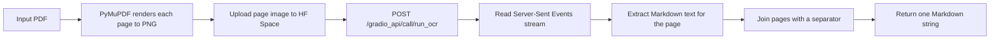

# PDF Extract: PDF → Markdown with Baidu Unlimited-OCR

A small, experiment-driven Python project for converting PDF documents into Markdown with the
[Baidu Unlimited-OCR](https://huggingface.co/baidu/Unlimited-OCR) vision-language model.

The repository contains three things:

1. **A reusable client** — `pdf_to_md.py` renders each PDF page locally with PyMuPDF, uploads the
   page image to the public `baidu/Unlimited-OCR` Hugging Face Space, and streams OCR results back
   as Markdown.
2. **An API lab notebook** — a sequence of scripts (`ocr_api*.py`, `debug_api.py`, `test_*.py`) that
   document how the Gradio/HTTP endpoint was reverse-engineered and made reliable.
3. **A local CPU fallback** — scripts that run the same model directly through `transformers` when
   using the hosted Space is not an option.

A 21-page research paper is included as a test fixture, along with a partial Markdown extraction
produced by the local CPU pipeline.

> **Status:** working prototype / research scratchpad. Only `pdf_to_md.py` is intended as reusable
> library code. The remaining scripts are experiments, probes, and one-off runs. There is no CLI,
> test suite, or published package yet.

---

## Why this exists

Most PDF-to-Markdown tools depend on the PDF's embedded text layer. That works well for born-digital
documents, but breaks down for scans, image-heavy pages, unusual layouts, formulas, tables, and
documents whose text layer is missing, broken, or badly ordered.

Unlimited-OCR is a vision-language OCR model: it looks at an image of the page and generates the
content directly. Rendering pages to images and OCR'ing them sidesteps the text layer entirely.

This repo started as a "can I get a clean Markdown version of a research paper?" experiment. It grew
into a small client plus a record of the API probing required to make the hosted model usable from
plain Python.

## Features

- Page-by-page PDF rendering at a configurable DPI (default `200`).
- OCR on Hugging Face ZeroGPU, so no local GPU is required.
- Two OCR modes: `base` (1024 px, accuracy-oriented) and `gundam` (640 px crop, faster).
- Retry handling for ZeroGPU queue contention and empty results.
- Per-page progress callback for logging or progress bars.
- Configurable page separator in the returned Markdown.
- Local CPU inference scripts for offline use.
- Checked-in sample input and sample output.

## How it works



The hosted path, step by step:

1. **Render locally.** `fitz` (PyMuPDF) opens the PDF and rasterises every page at `dpi / 72`
   scale. Working locally gives control over resolution and avoids uploading the whole PDF.
2. **Upload the page.** The PNG is posted to the Space's `/gradio_api/upload` endpoint with an
   `Authorization: Bearer <HF_TOKEN>` header. The Space returns a server-side path.
3. **Call the OCR function.** A Gradio `FileData` object is constructed for the uploaded image and
   sent to `/gradio_api/call/run_ocr` together with the mode and the prompt
   `"Multi page parsing."`.
4. **Stream the result.** Gradio returns an `event_id`; the client opens the corresponding SSE
   stream and reads `generating`, `heartbeat`, `complete`, and `error` events. The `complete` event
   carries the page Markdown.
5. **Join and return.** Page texts are joined with `\n\n---\n\n` (configurable) and returned as a
   single string.

The local path skips steps 2–4: it loads `baidu/Unlimited-OCR` with `transformers`, patches the
model's CUDA assumptions, and calls `model.infer_multi()` directly on the page image.

## Quick start: hosted Space

### Prerequisites

- Python 3.12 or newer
- [`uv`](https://docs.astral.sh/uv/) (recommended) or `pip`
- A Hugging Face account and a user access token with access to the
  [`baidu/Unlimited-OCR` Space](https://huggingface.co/spaces/baidu/Unlimited-OCR)

### Install

```bash
git clone https://github.com/dezmymachine/pdf-extract.git
cd pdf-extract
uv sync
```

Or with plain `pip`:

```bash
python -m venv .venv
source .venv/bin/activate
pip install -e .
```

### Provide the token

The scripts read the token from the `HF_TOKEN` environment variable. Never hard-code it.

```bash
export HF_TOKEN="hf_..."
```

On Windows PowerShell:

```powershell
$env:HF_TOKEN = "hf_..."
```

### Extract a PDF

```python
import logging
import os

from pdf_to_md import pdf_to_markdown

logging.basicConfig(level=logging.INFO, format="%(message)s")

markdown = pdf_to_markdown(
    "rag_paper.pdf",
    hf_token=os.environ["HF_TOKEN"],
    mode="base",
    dpi=200,
    on_page_done=lambda page, total, seconds: print(
        f"page {page}/{total} done in {seconds:.0f}s"
    ),
)

with open("output.md", "w", encoding="utf-8") as f:
    f.write(markdown)
```

Or run the included end-to-end script, which writes `rag_paper.md`:

```bash
uv run python test_module.py
```

For a quicker smoke test that only prints the first 3,000 characters:

```bash
uv run python test_hf_space.py
```

## API reference

```python
pdf_to_markdown(
    pdf_path: str | Path,
    hf_token: str,
    *,
    mode: Literal["base", "gundam"] = "base",
    dpi: int = 200,
    space_url: str = "https://baidu-unlimited-ocr.hf.space",
    max_retries: int = 5,
    retry_delay: int = 30,
    page_timeout: int = 300,
    page_break: str = "\n\n---\n\n",
    on_page_done: Callable[[int, int, float], None] | None = None,
) -> str
```

| Parameter | Default | Description |
|---|---|---|
| `pdf_path` | — | Path to the PDF to process. |
| `hf_token` | — | Hugging Face user access token. |
| `mode` | `"base"` | OCR mode. `base` uses 1024 px input; `gundam` uses a faster 640 px crop. |
| `dpi` | `200` | Rasterisation resolution for the local PDF-to-image step. |
| `space_url` | `https://baidu-unlimited-ocr.hf.space` | Base URL of the Hugging Face Space. |
| `max_retries` | `5` | Attempts per page when the result is empty or ZeroGPU is busy. |
| `retry_delay` | `30` | Base delay in seconds. ZeroGPU retries use `retry_delay * attempt`. |
| `page_timeout` | `300` | HTTP timeout budget per page, in seconds. |
| `page_break` | `"\n\n---\n\n"` | Separator inserted between pages. |
| `on_page_done` | `None` | Called after each page with `(page_number, total_pages, elapsed_seconds)`. |

**Returns:** the full document as one Markdown string.

**Raises:**

- `ImportError` if PyMuPDF is not installed.
- `httpx.HTTPStatusError` if an upload or API request fails at the HTTP level.
- `RuntimeError` if the Space reports an error, or if a page still fails after `max_retries`.

### Choosing a mode

| Mode | Input size | When to use it |
|---|---|---|
| `base` | 1024 px | Final extraction. Better detail on small text, formulas, and footnotes. |
| `gundam` | 640 px crop | Quick tests, large clean text, or when the ZeroGPU queue is slow. |

### Tuning tips

- **Small text or dense formulas:** raise `dpi` to `250`–`300`. This increases upload size and OCR
  time, but gives the model more pixels to work with.
- **Frequent "No GPU was available" errors:** raise `max_retries` and/or `retry_delay`.
- **Large documents:** process in page ranges yourself and join the results, rather than one very
  long run. The client is sequential and keeps every page in memory.
- **Timeout errors:** raise `page_timeout`. The HTTP client uses `page_timeout + 30` seconds.

## Repository layout

### Core files

| Path | Purpose |
|---|---|
| `pdf_to_md.py` | Reusable hosted-Space client. The main artifact of the project. |
| `pyproject.toml` | Project metadata and runtime dependencies (`httpx`, `pymupdf`). |
| `uv.lock` | Locked dependency graph for `uv`. |
| `.env.example` | Template showing the expected `HF_TOKEN` variable. |

### Hosted API experiments

These are ordered roughly by evolution. Earlier scripts are kept because they document the API
quirks that the final client handles.

| Path | Purpose |
|---|---|
| `test_module.py` | End-to-end run of `pdf_to_markdown` on `rag_paper.pdf`; writes `rag_paper.md`. Start here. |
| `test_hf_space.py` | Smoke test using `gundam` mode; prints the first 3,000 characters. |
| `ocr_api.py` | Early `gradio_client` approach: upload the PDF, call `/explode_pdf`, OCR each returned page. |
| `ocr_api2.py` | Raw `httpx` upload and `/explode_pdf` probe. Incomplete by design. |
| `ocr_api3.py` | Local PDF-to-image conversion combined with `gradio_client`. |
| `ocr_api4.py` | Local rendering plus a raw streaming `POST` to the Gradio endpoint. |
| `ocr_api5.py` | Closest predecessor to the final client: raw HTTP, Gradio `FileData`, and SSE parsing. |
| `debug_api.py` | Dumps raw SSE lines for a single page; useful when the response format changes. |
| `test_debug.py` | Uploads a PDF and dumps the raw `/explode_pdf` event stream. |
| `test_flow.py` | Full upload + `/explode_pdf` flow with explicit error handling. |

### Local CPU inference

These scripts load `baidu/Unlimited-OCR` through `transformers` and run it without CUDA. They are
slow and hacky, but they remove the dependency on the hosted Space.

| Path | Purpose |
|---|---|
| `run_cpu_save.py` | Extracts pages 1, 2, and 11 into `rag_paper.md`. Produced the checked-in sample. |
| `ocr_final.py` | Extracts pages 1, 2, and 21 into `ocr_pages/`. |
| `ocr_full.py` | Runs pages 1, 2, 6, 11, and 21; writes to `ocr_output_cpu/`. |
| `ocr_test.py` | First CPU test: two pages at 150 DPI. |
| `ocr_cpu_patched.py` | Single-page run with more elaborate CUDA-neutralising patches. |

Generated output directories (`ocr_output/`, `ocr_output_cpu/`, `ocr_pages/`) and the scratch file
`ocr_output.txt` are intentionally ignored by Git.

### Sample data

| Path | Description |
|---|---|
| `rag_paper.pdf` | 21-page LaTeX-generated paper: *Retrieval-Augmented Generation for Large Language Models: A Survey*. Used as the test fixture. |
| `rag_paper.md` | Partial OCR output for pages 1, 2, and 11, produced on CPU. |

## Sample output

`rag_paper.md` is deliberately partial: it contains three of the paper's 21 pages. The first page
shows the kind of structure the model recovers:

```markdown
## Page 1

<PAGE>
1
Retrieval-Augmented Generation for Large Language Models: A Survey
Yunfan Gao \( ^{a} \) , Yun Xiong \( ^{b} \) , ...

Abstract—Large Language Models (LLMs) showcase impressive capabilities but encounter
challenges like hallucination, outdated knowledge, and non-transparent, untraceable
reasoning processes. ...
```

The extraction preserves headings, paragraph structure, inline math notation, citation brackets, and
author affiliations reasonably well. It does **not** export figures as image files; figure captions
and in-figure text may appear as plain text. Minor OCR artifacts remain (for example, a missing word
or a misread line break), so the output should be reviewed before being treated as authoritative.

## Running the model locally on CPU

The local scripts are not part of the minimal install. You will need PyTorch, Transformers, and
Accelerate:

```bash
pip install torch transformers accelerate
```

The model's remote code assumes CUDA. The scripts work around this by neutralising the CUDA calls
before importing the model:

```python
import os

import torch

torch.Tensor.cuda = lambda self, *args, **kwargs: self
os.environ["CUDA_VISIBLE_DEVICES"] = ""
```

Then they load the model and run `infer_multi`:

```python
from transformers import AutoModel, AutoTokenizer

tokenizer = AutoTokenizer.from_pretrained("baidu/Unlimited-OCR", trust_remote_code=True)
model = AutoModel.from_pretrained(
    "baidu/Unlimited-OCR",
    trust_remote_code=True,
    use_safetensors=True,
    dtype=torch.bfloat16,
    device_map="cpu",
).eval()

model.infer_multi(
    tokenizer,
    prompt="<image>Multi page parsing.",
    image_files=[page_image_path],
    output_path="ocr_pages",
    image_size=1024,
    max_length=32768,
    no_repeat_ngram_size=35,
    ngram_window=1024,
    save_results=False,
)
```

This is a compatibility hack, not a supported CPU deployment path. Expect **minutes per page** on a
typical CPU, large memory use, and model downloads measured in gigabytes. A GPU is strongly
recommended for anything beyond a few pages.

To choose different pages, edit the `pages_to_extract` list in `run_cpu_save.py` (zero-based page
indices) and run:

```bash
python run_cpu_save.py
```

## Design notes and trade-offs

**Why render pages locally instead of uploading the PDF?** It gives explicit control over DPI, makes
retries page-granular, keeps progress reporting simple, and avoids depending on the Space's
`/explode_pdf` helper, whose return shape changed during development.

**Why one page per request?** ZeroGPU allocates compute per call, and page-level requests fail
independently. A single bad page does not lose the whole document. The cost is more uploads and no
cross-page context.

**Why a custom HTTP/SSE client instead of `gradio_client`?** The raw client gives control over
timeouts, retries, headers, and the exact `FileData` payload. It also made the ZeroGPU error
messages visible, which the retry logic depends on.

**Trade-offs:**

- Sequential processing only; no concurrency.
- OCR quality depends on DPI and page layout.
- Figures are not extracted as separate assets.
- The page separator is plain Markdown, not a structured document model.
- Temporary page images are cleaned up on success; an exception can leave a `pdf_to_md_*` directory
  in the system temp folder.

## Troubleshooting

| Symptom | Likely cause | What to try |
|---|---|---|
| `401` / `403` from the Space | Missing, invalid, or expired `HF_TOKEN` | Check `echo $HF_TOKEN`; create a fresh token; make sure the Space is accessible to your account. |
| `No GPU was available` / `ZeroGPU` errors | Shared GPU queue is busy | Increase `max_retries` and `retry_delay`; retry later. |
| Empty page result | Model returned nothing for that page | The client retries automatically; try `gundam` mode or a higher DPI. |
| Request timeout | Large page, slow queue, or network | Raise `page_timeout`; lower `dpi`; retry. |
| `ImportError: pymupdf is required` | PyMuPDF is not installed | `uv sync` or `pip install pymupdf`. |
| Local model fails with CUDA errors | Remote code assumes a GPU | Use the monkey-patch shown above; keep `CUDA_VISIBLE_DEVICES=""`. |
| Local run is extremely slow | CPU inference | Process only a few pages, or use the hosted Space. |
| Garbled output on dense pages | Resolution or layout | Raise DPI; try `base` mode; inspect the rendered PNG. |

## Security

- **Never commit a Hugging Face token.** All scripts read `HF_TOKEN` from the environment, and
  `.env` is ignored by Git.
- If you previously hard-coded a token in a local copy of these scripts, revoke it at
  <https://huggingface.co/settings/tokens> and create a new one.
- Treat OCR output as untrusted text. It is model-generated and can contain errors or unexpected
  content.

## Limitations and possible next steps

Current limitations:

- Only the first three pages of the sample paper are extracted in the checked-in Markdown.
- No automated tests, CI, CLI, or packaging beyond `pyproject.toml`.
- No resume/checkpoint support: a failed run starts over.
- No upload cache, so re-runs re-upload every page.
- No parallel page processing.
- Text-only output: figures, charts, and tables are not exported as structured assets.
- The hosted Space is a third-party dependency and may change, rate-limit, or disappear.

Ideas for a next iteration:

- A proper CLI: `pdf-extract input.pdf -o output.md --mode base --dpi 250`.
- Concurrent page processing with a bounded worker pool.
- Resume support keyed by PDF hash and page number.
- A fast path that uses the PDF text layer when it is good, and falls back to OCR otherwise.
- Layout-aware post-processing for tables, figures, and reading order.
- Automated tests with recorded SSE fixtures, so the parser can be tested without the Space.

## Acknowledgements

- [Baidu Unlimited-OCR](https://huggingface.co/baidu/Unlimited-OCR) for the model and hosted Space.
- [PyMuPDF](https://pymupdf.readthedocs.io/) for PDF rendering.
- [Hugging Face Spaces](https://huggingface.co/spaces) and [Gradio](https://www.gradio.app/) for
  the hosted inference API.
- The authors of the sample paper, used here only as a test fixture.

## Citation

The sample document is:

```bibtex
@article{gao2023retrieval,
  title   = {Retrieval-Augmented Generation for Large Language Models: A Survey},
  author  = {Gao, Yunfan and Xiong, Yun and Gao, Xinyu and Jia, Kangxiang and Pan, Jinliu
             and Bi, Yuxi and Dai, Yi and Sun, Jiawei and Wang, Meng and Wang, Haofen},
  journal = {arXiv preprint arXiv:2312.10997},
  year    = {2023}
}
```

## License

No license file is included. Treat the code as all-rights-reserved until a license is added. The
sample paper remains the property of its authors and is included only as a testing fixture.
